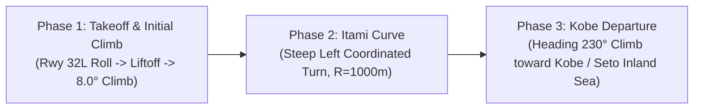

# Itami 32L Flight Simulator — User & Technical Manual

[日本語マニュアルはこちら (Japanese Manual)](./MANUAL_JA.md)

---

## Table of Contents
1. [Overview & Flight Profile](#1-overview--flight-profile)
2. [Quick Start & Setup](#2-quick-start--setup)
3. [User Interface & Screen Layout](#3-user-interface--screen-layout)
4. [Controls & Keyboard Shortcuts](#4-controls--keyboard-shortcuts)
5. [Flight Parameters & Presets](#5-flight-parameters--presets)
6. [Camera Modes](#6-camera-modes)
7. [Primary Flight Display (PFD / HUD)](#7-primary-flight-display-pfd--hud)
8. [Physics & Aerodynamics Engine](#8-physics--aerodynamics-engine)
9. [3D Terrain & GeoTIFF Elevation](#9-3d-terrain--geotiff-elevation)
10. [Procedural Jet Engine Sound](#10-procedural-jet-engine-sound)
11. [Python Trajectory Module](#11-python-trajectory-module)

---

## 1. Overview & Flight Profile

The **Itami 32L Flight Simulator** is a high-fidelity interactive 3D WebGL flight visualization and physics sandbox reproducing Osaka International Airport (Itami - RJOO / ITM), Runway 32L takeoff, and the world-famous **"Itami Curve"** Noise Abatement Departure Procedure (NADP).

### The 3 Departure Phases:


1. **Phase 1 (Runway Roll & Straight Climb)**:
   - Aircraft accelerates on Runway 32L (Heading 315.5°).
   - Liftoff at ~1,300m roll distance, initiating steep initial climb at 8.0° angle.
   - Reaches Phase 1 waypoint at 3,000m from runway threshold.
2. **Phase 2 (The Famous "Itami Curve")**:
   - Immediate steep left-hand banking turn over the Itami residential area and Ina/Muko rivers.
   - Designed to avoid the imposing Rokko Mountain Range (elevation up to 925m) and reduce noise impact.
   - Coordinated turn with nominal bank angle $\approx 33^\circ$ and load factor $\approx 1.2\text{G}$.
3. **Phase 3 (Departure Climb toward Kobe)**:
   - Wings level on departure heading (230.0°).
   - Sustained cruise climb (6.0°) heading southwest towards Kobe and the Seto Inland Sea.

---

## 2. Quick Start & Setup

### Prerequisites
- **Node.js** (v18.0.0 or higher recommended)
- **Modern Web Browser** with WebGL 2.0 and Web Audio API support (Chrome, Edge, Safari, Firefox)

### Installation & Execution
```bash
# 1. Navigate to the project folder
cd /path/to/flight_departure

# 2. Install dependencies
npm install

# 3. Start local development server
npm run dev
```
Open your browser and navigate to `http://localhost:5173/`.

### Production Build & Preview
```bash
# Build production bundle
npm run build

# Preview production build locally
npm run preview
```

---

## 3. User Interface & Screen Layout

The simulator interface consists of five distinct, non-intrusive HUD panels:

```
+-------------------------------------------------------------------------+
| [RJOO/ITM 32L]                   [1:Chase] [2:Cockpit] [3:Wing] ...     | <- Top Header
+-------------------+---------------------------------+-------------------+
|                   |                                 |                   |
|  [PFD / HUD]      |                                 | [Parameter Panel] |
|  - Attitude       |         3D WebGL Viewport       | - Presets         |
|  - Airspeed Tape  |                                 | - Sliders         |
|  - Altitude Tape  |                                 | - Sky / Lighting  |
|  - VSI / Compass  |                                 | - Reset Button    |
|                   |                                 |                   |
+-------------------+---------------------------------+-------------------+
| [Telemetry Cards] ALT / SPD / HDG / BANK / G-FORCE / VERT SPEED         |
| [Timeline Dock]   (Play/Pause) [====(PH1)==(PH2)==(PH3)====] (1x) (Mute)| <- Bottom Dock
+-------------------------------------------------------------------------+
```

1. **Top Header**: Airport badge and Camera View Switcher.
2. **Left HUD (PFD)**: Real-time Primary Flight Display rendering attitude, airspeed, altitude, heading, and G-force.
3. **Right Parameter Control Panel**: Real-time sliders, departure presets, and sky atmosphere toggle.
4. **Bottom Dock**: Real-time numerical telemetry cards and interactive playback scrub bar with Phase markers.
5. **Center 3D Viewport**: High-performance Three.js rendering engine with shadow mapping and atmospheric fog.

---

## 4. Controls & Keyboard Shortcuts

### 4.1 General Controls
| Key / Action | Function | Description |
| :--- | :--- | :--- |
| <kbd>Tab</kbd> | **Flight Mode Switch** | Toggle between "Auto Route Tracking" and "Manual Free Flight" |
| <kbd>1</kbd> | **Chase Cam** | Third-person follow camera smoothly tracking aircraft roll and pitch |
| <kbd>2</kbd> | **Cockpit HUD** | Pilot flight deck view looking through the nose forward |
| <kbd>3</kbd> | **Wing View** | Passenger cabin window perspective over right wing and turbofan engine |
| <kbd>4</kbd> | **Tower Spotter** | Telephoto tracking camera mounted on Itami ATC Control Tower |
| <kbd>5</kbd> | **Free Orbit** | Full 360° mouse-controlled orbit camera (Drag: rotate, Scroll: zoom) |
| <kbd>6</kbd> | **Radar Map** | High-altitude tactical top-down view (North-up) |
| <kbd>Space</kbd> | **Play / Pause** | Toggle simulation playback in Auto Route mode |
| <kbd>M</kbd> | **Mute / Audio** | Toggle procedural Web Audio jet engine sound synthesis |
| <kbd>R</kbd> | **Reset Flight** | Reset aircraft to stationary state at Runway 32L threshold |
| <kbd>L</kbd> | **Toggle Loop** | Toggle automatic replay loop in Auto Route mode |

### 4.2 Manual Free Flight Controls
| Control Axis | Keyboard | Description |
| :--- | :--- | :--- |
| **Throttle (Thrust)** | <kbd>Shift</kbd> / <kbd>W</kbd> (Increase)<br><kbd>Ctrl</kbd> / <kbd>S</kbd> (Decrease) | Smoothly adjusts engine thrust (0% to 100% TOGA) |
| **Pitch (Elevator)** | <kbd>↓</kbd> (Pull yoke: Nose UP)<br><kbd>↑</kbd> (Push yoke: Nose DOWN) | Controls aircraft angle of attack $\alpha$ and climb/descent |
| **Roll (Ailerons)** | <kbd>←</kbd> / <kbd>A</kbd> (Bank Left)<br><kbd>→</kbd> / <kbd>D</kbd> (Bank Right) | Banks wings to initiate coordinated aerodynamic turns |
| **Yaw (Rudder)** | <kbd>Q</kbd> (Left) / <kbd>E</kbd> (Right) | Yaw coordination & ground nosewheel steering |
| **Landing Gear** | <kbd>G</kbd> | Retract (UP) / Extend (DOWN) landing gear |
| **Flaps** | <kbd>F</kbd> | Cycle flap extension ($0^\circ \rightarrow 5^\circ\text{ (TO)} \rightarrow 15^\circ \rightarrow 30^\circ\text{ (LDG)}$) |
| **Wheel Brakes** | <kbd>B</kbd> | Toggle ground wheel brakes |

---

### 🛫 Step-by-Step Manual Flight Tutorial

1. **Switch to Manual Flight Mode**:
   - Click "**Manual Flight**" in the right control panel or press <kbd>Tab</kbd>.
2. **Apply Takeoff Thrust (Takeoff Roll)**:
   - Hold <kbd>Shift</kbd> or <kbd>W</kbd> until throttle reaches **100% (TOGA)**.
   - The airliner will accelerate down Runway 32L (use <kbd>Q</kbd> / <kbd>E</kbd> for subtle steering).
3. **Rotation & Liftoff**:
   - When airspeed reaches **140–150 KT**, hold <kbd>↓</kbd> (Down Arrow: pull yoke) to pitch the nose up by $8^\circ - 10^\circ$.
   - Once airborne, press <kbd>G</kbd> to retract landing gear (UP).
4. **Execute the Famous Itami Curve (Left Turn)**:
   - Climbing through 500–800 FT, press <kbd>←</kbd> or <kbd>A</kbd> to bank left ($25^\circ - 30^\circ$).
   - Tap <kbd>↓</kbd> gently as needed during the turn to maintain positive climb rate.
   - When heading reaches **230°** (Southwest toward Kobe / Osaka Bay), press <kbd>→</kbd> or <kbd>D</kbd> to level the wings.
5. **Climb & Departure Cruise**:
   - Manage throttle ($80\% - 90\%$) with <kbd>Shift</kbd> / <kbd>Ctrl</kbd> to cruise toward Kobe.
   - Press <kbd>R</kbd> anytime to restart instantly from the runway.

---

#### 💥 Mountain & Terrain Collision (Game Over System)
- If the aircraft impacts the Rokko Mountain Range (elevation up to 925m), Hokusetsu hills, or crashes outside the airport corridor, **the screen flashes in dynamic red with an explosion shockwave sound and terminates the flight (TERRAIN COLLISION)**.
- The game-over modal displays impact speed (KT), elevation (M), and impact location name.
- Press <kbd>R</kbd> or click the "Restart Flight [R]" button to instantly retry from Runway 32L.

---

## 5. Flight Parameters & Presets

### Built-in Presets
- **Standard Itami NADP**: Nominal departure profile for Boeing 737 / Airbus A320 ($V=80\text{ m/s}, R=1000\text{ m}, \theta_{\text{climb}}=8.0^\circ$).
- **Sharp Noise Abatement (R=750m)**: Steep climb and high bank turn ($V=75\text{ m/s}, R=750\text{ m}, \theta_{\text{climb}}=10.5^\circ, \text{Bank}\approx 38^\circ$).
- **Heavy Widebody Jet**: Gentle profile for Boeing 777 / 787 ($V=95\text{ m/s}, R=1400\text{ m}, \theta_{\text{climb}}=5.5^\circ$).
- **💥 Mountain Impact Demo**: CFIT failure scenario where the aircraft fails to turn left (flies straight for 12,000m with shallow 2.0° climb) and impacts the Nakayama / Rokko mountain ridge at $t \approx 122\text{s}$ (elevation ~340m / 1,100ft).
- **🚨 Engine Stall Dive Demo**: Emergency failure scenario where engines stall during initial turn and pitch down into a steep dive ($-18.0^\circ$), impacting the urban ground at $t \approx 53\text{s}$.

### Real-Time Parameter Sliders
| Parameter | Slider ID | Range | Default | Aviation Unit |
| :--- | :--- | :--- | :--- | :--- |
| **Airspeed ($V$)** | `param-speed` | $60 - 110\text{ m/s}$ | $80\text{ m/s}$ | $155\text{ kt}$ |
| **Liftoff Roll Distance** | `param-liftoffDist` | $800 - 2,200\text{ m}$ | $1,300\text{ m}$ | Ground roll distance |
| **Initial Climb Angle ($\theta_1$)** | `param-climbAngDeg` | $1.0^\circ - 14.0^\circ$ | $8.0^\circ$ | Climb gradient ($FPM \propto \sin\theta$) |
| **Phase 1 Straight Distance** | `param-d1Total` | $2,000 - 15,000\text{ m}$| $3,000\text{ m}$ | Distance before initiating turn |
| **Itami Curve Radius ($R$)** | `param-rTurn` | $600 - 1,800\text{ m}$ | $1,000\text{ m}$ | Turn radius over Itami / Muko River |
| **Turn Sweep Arc** | `param-turnArcDeg` | $0.0^\circ - 120^\circ$ | $90.0^\circ$ | Total angle traversed in turn (0° = straight) |
| **Cruise Climb Angle ($\theta_3$)** | `param-cruiseClimbDeg`| $-25.0^\circ - 12.0^\circ$| $6.0^\circ$ | Phase 3 departure climb / dive |
| **Runway Heading** | `param-hdgRwyDeg` | $312.0^\circ - 320.0^\circ$| $315.5^\circ$ | Magnetic heading of Runway 32L |

---

## 6. Camera Modes

1. **Chase Cam (Key: `1`)**:
   - Follows 65m behind and 18m above aircraft fuselage.
   - Features dynamic lerp smoothing and rolls with the aircraft bank angle.
2. **Cockpit HUD (Key: `2`)**:
   - Positioned at flight deck nose (+27.5m forward, +1.3m altitude).
   - Provides true pilot perspective aligned with trajectory flight vector.
3. **Wing View (Key: `3`)**:
   - Passenger cabin window seat positioned just behind the right wing root.
   - Shows turbofan engine cowling, wing flex, and rotating terrain below.
4. **Tower Spotter (Key: `4`)**:
   - Fixed camera located at Itami ATC Control Tower (elevation 65m).
   - Telephoto narrow Field-of-View ($30^\circ$) automatically tracking the departing aircraft.
5. **Free Orbit (Key: `5`)**:
   - Full 3D orbital control centered on the aircraft.
   - Left click + drag to rotate, right click to pan, scroll wheel to zoom.
6. **Radar Map (Key: `6`)**:
   - Tactical top-down view from 5,500m altitude with North-up orientation.
   - Displays trajectory 3D ribbon and waypoint pillars over Osaka basin.

---

## 7. Primary Flight Display (PFD / HUD)

The PFD is rendered dynamically on an HTML5 2D Canvas with Retina resolution:
- **Attitude Horizon Indicator**: Blue sky / brown ground divider with roll angle indexing and pitch ladder ($\pm 40^\circ$ in $10^\circ$ increments).
- **Airspeed Tape (Left)**: Calibrated airspeed in Knots (KT) with moving tape and digital readout box.
- **Altitude Tape (Right)**: Barometric altitude in Feet (FT) above sea level.
- **Vertical Speed Indicator (VSI)**: Rate of climb/descent in Feet Per Minute (FPM).
- **Heading Compass (Bottom)**: 3-digit magnetic heading display with compass rose tick marks.
- **Top Annunciator**: Current active flight phase (`PHASE 1: RUNWAY / CLIMB`, `PHASE 2: ITAMI CURVE`, `PHASE 3: KOBE DEPARTURE`).
- **G-Force Meter**: Instantaneous load factor (e.g., $1.20\text{G}$).

---

## 8. Physics & Aerodynamics Engine

### Coordinated Turn Physics
During the Itami Curve (Phase 2), the bank angle $\phi$ is calculated to achieve an equilibrium coordinated turn with zero lateral side-slip:
$$\tan(\phi) = \frac{v^2}{g \cdot R}$$
Where:
- $v$: True airspeed ($\text{m/s}$)
- $g$: Acceleration due to gravity ($9.80665\text{ m/s}^2$)
- $R$: Curve radius ($\text{m}$)

### G-Force (Load Factor)
The resultant G-force experienced by passengers and airframe is:
$$G = \frac{1}{\cos(\phi)}$$

### Flight Trajectory Coordinate Mapping
The simulator maps navigational coordinates $(\text{East}, \text{North}, \text{Altitude})$ into Three.js 3D space:
- $\text{Three.js } +X = \text{East } (+x)$
- $\text{Three.js } +Y = \text{Altitude } (+z) + 18.0\text{ m}$ (13.5m terrain base + 4.5m landing gear offset)
- $\text{Three.js } -Z = \text{North } (+y)$

---

## 9. 3D Terrain & GeoTIFF Elevation

- **Elevation DEM Grid**: Generated from Geospatial Information Authority of Japan (GSI) 5m/10m GeoTIFF DEM data converted into binary Float32 grid (`/data/elevation.bin` and `elevation_meta.json`).
- **Satellite Orthophoto**: High-resolution aerial orthophotography texture mapped across Osaka, Hyogo, Rokko Mountain Range, and Osaka Bay.
- **Runway & Markings**:
  - Main Runway 32L/14R ($3,000\text{m} \times 60\text{m}$) with threshold piano keys, touchdown zone markers, and edge lighting.
  - Secondary Runway 32R/14L ($1,828\text{m} \times 45\text{m}$).
- **Surrounding Landmarks**:
  - Ina River & Muko River water bodies.
  - Koyaike Pond with its iconic Japan-shaped central island.
  - Procedural city buildings with safety exclusion zones around runways and departure funnels.

---

## 10. Procedural Jet Engine Sound

Synthesized in real-time using the **Web Audio API** (no external audio files required):
1. **Low-Frequency Jet Rumble**: Filtered pink/brown noise passing through a 140Hz low-pass biquad filter.
2. **High-Bypass Turbine Whine**: Pure sine oscillator with frequency modulated dynamically by airspeed ($480\text{Hz} - 800\text{Hz}$).
3. **Aerodynamic Wind Noise**: Bandpass-filtered air rush noise.
4. **Distance Attenuation**: Volume and frequency response automatically attenuate based on camera distance to aircraft.

---

## 11. Python Trajectory Module

A standalone Python trajectory generator is provided under `python/trajectory.py`:
```bash
# Run standalone Python trajectory test
python3 python/trajectory.py
```
This script computes waypoints, bank angles, velocity vectors, and G-forces identically to the JavaScript engine, suitable for offline data analysis, Matplotlib plotting, or MuJoCo RL training pipelines.

---
*© 2026 Itami 32L Flight Simulator Project*
