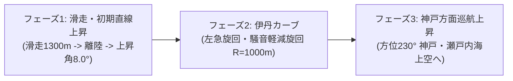

# 伊丹 32L フライトシミュレーター — 取扱説明書・仕様解説書

[English Manual is here (英語マニュアル)](./MANUAL_EN.md)

---

## 目次
1. [概要・飛行プロファイル](#1-概要飛行プロファイル)
2. [クイックスタート・起動方法](#2-クイックスタート起動方法)
3. [画面構成・ユーザーインターフェース](#3-画面構成ユーザーインターフェース)
4. [操作方法・キーボードショートカット一覧](#4-操作方法キーボードショートカット一覧)
5. [飛行パラメータとプリセット](#5-飛行パラメータとプリセット)
6. [カメラ視点（6モード）](#6-カメラ視点6モード)
7. [コックピット計器（PFD / HUD）の見方](#7-コックピット計器pfd--hudの見方)
8. [飛行力学・旋回物理モデル](#8-飛行力学旋回物理モデル)
9. [3D地形データ（GeoTIFF標高DEM＋衛星オルソ画像）](#9-3d地形データgeotiff標高dem衛星オルソ画像)
10. [Web Audio 音響シンセサイザー](#10-web-audio-音響シンセサイザー)
11. [Python軌道計算モジュール](#11-python軌道計算モジュール)

---

## 1. 概要・飛行プロファイル

**Itami 32L Flight Simulator（伊丹32Lフライトシミュレーター）** は、大阪国際空港（伊丹空港 - RJOO / ITM）の滑走路 32L（Runway 32L）からの離陸および、航空ファンの間で世界的にも名高い**「伊丹カーブ（Itami Curve）」騒音軽減出発方式（NADP）**を高精度に再現したインタラクティブ3D WebGLフライトシミュレーターです。

### 3段階の飛行プロファイル


1. **フェーズ 1（滑走路滑走・初期上昇区間）**:
   - 滑走路 32L（磁方位 315.5°）をフルスロットルで滑走開始。
   - 滑走距離約 1,300m でリフトオフ（離陸）、初期上昇角 8.0° で急上昇。
   - 滑走路端から 3,000m 地点（猪名川上空付近）でフェーズ 1 終了。
2. **フェーズ 2（名物「伊丹カーブ」急旋回区間）**:
   - 伊丹市街地上空・昆陽池周辺にて、北西にそびえる六甲山地（最高標高 925m）の山岳回避と騒音軽減のため、左へ急旋回（バンク角 約33°、G力 1.2G）。
   - 旋回半径 1,000m、旋回角 90° で武庫川上空を越えながら西へ変向。
3. **フェーズ 3（神戸方面出発上昇区間）**:
   - 水平飛行姿勢に戻し、出発方位 230.0°（神戸・瀬戸内海方面）へ向けて上昇角 6.0° で安定した巡航上昇へ移行。

---

## 2. クイックスタート・起動方法

### 動作環境
- **Node.js**: v18.0.0 以上推奨
- **対応ブラウザ**: WebGL 2.0 および Web Audio API に対応したモダンブラウザ（Google Chrome, Microsoft Edge, Apple Safari, Mozilla Firefox）

### 起動手順
```bash
# 1. プロジェクトディレクトリへ移動
cd /Users/shun_ishii/Projects/N49_flight_departure/flight_departure

# 2. 依存パッケージのインストール
npm install

# 3. 開発サーバーの起動
npm run dev
```
起動後、ブラウザで `http://localhost:5173/` にアクセスしてください。

### プロダクションビルド・動作確認
```bash
# 本番用静的アセットのビルド
npm run build

# ビルド成果物のローカルプレビュー
npm run preview
```

---

## 3. 画面構成・ユーザーインターフェース

画面は操作性と視認性を追求した5つのHUDモジュールで構成されています：

```
+-------------------------------------------------------------------------+
| [RJOO/ITM 32L]                   [1:Chase] [2:Cockpit] [3:Wing] ...     | <- 上部ヘッダー
+-------------------+---------------------------------+-------------------+
|                   |                                 |                   |
|  [PFD / HUD]      |                                 | [設定パネル]      |
|  - 姿勢指示器     |         3D WebGL ビューポート   | - プリセット選択  |
|  - 対気速度テープ |                                 | - 各種スライダー  |
|  - 高度テープ     |                                 | - 空・時間帯切替  |
|  - 昇降計/方位計  |                                 | - リセットボタン  |
|                   |                                 |                   |
+-------------------+---------------------------------+-------------------+
| [テレメトリ表示] 高度 / 対気速度 / 方位 / バンク角 / G力 / 垂直上昇速度 |
| [タイムライン]   (再生/一時停止) [====(PH1)==(PH2)==(PH3)====] (1x) (音) | <- 下部ドック
+-------------------------------------------------------------------------+
```

1. **上部ヘッダー（Top Header）**: 空港名・滑走路タグとカメラ視点切替ツールバー。
2. **左側 PFD / HUD（Primary Flight Display）**: 旅客機の実機コックピット計器を模したリアルタイム姿勢・速度・高度HUD。
3. **右側 パラメータ制御パネル（Control Panel）**: 飛行ルートのプリセット切替、各物理パラメータのリアルタイム調整スライダー、時間帯（夕景・昼・夜）切替。
4. **下部 テレメトリ＆タイムラインドック（Bottom Dock）**: リアルタイム数値表示（高度・速度・方位・バンク角・Gフォース・昇降率）と、フェーズマーカー付きシークバー、再生速度（0.5x〜4x）、ループ・サウンド切替。
5. **中央 3Dビューポート**: Three.js による高品質3D空間（航空機モデル、リアル地形、滑走路灯、大気フォグ）。

---

## 4. 操作方法・キーボードショートカット一覧

### 4.1 基本共通操作
| キー / 操作 | 機能 | 説明 |
| :--- | :--- | :--- |
| <kbd>Tab</kbd> | **モード切替** | 「自動軌道追従モード」$\leftrightarrow$「手動操縦（フリーフライト）モード」を切替 |
| <kbd>1</kbd> | **Chase Cam（追従視点）** | 機体後方から機体のロール・ピッチに滑らかに追従する三人称視点 |
| <kbd>2</kbd> | **Cockpit HUD（コックピット視点）** | パイロットの操縦席から機首前方の滑走路・地形を見渡す一人称視点 |
| <kbd>3</kbd> | **Wing View（客席窓視点）** | 右翼主翼およびジェットエンジンを見下ろす臨場感あふれる客室窓視点 |
| <kbd>4</kbd> | **Tower Spotter（管制塔視点）** | 伊丹空港の管制塔（高さ65m）から離陸機を自動追尾する望遠視点 |
| <kbd>5</kbd> | **Free Orbit（自由軌道カメラ）** | マウスドラッグで機体中心に360度自由回転・ズーム可能な視点 |
| <kbd>6</kbd> | **Radar Map（上空レーダー視点）** | 高度5,500mから大阪平野全体と飛行軌道を真下に見下ろす俯瞰マップ |
| <kbd>Space</kbd> | **再生 / 一時停止** | 自動軌道モード時のシミュレーション再生/一時停止 |
| <kbd>M</kbd> | **音響ミュート切替** | Web Audio によるジェットエンジン音の ON / OFF を切り替えます |
| <kbd>R</kbd> | **フライトリセット** | 滑走路 32L スタート地点（停止状態）に機体をリセットします |
| <kbd>L</kbd> | **ループ再生切替** | 自動軌道モード時の自動リピート再生を ON / OFF します |

### 4.2 手動操縦（フリーフライト）専用操作
| 操作系統 | キーボード | 役割 |
| :--- | :--- | :--- |
| **スロットル（推力）** | <kbd>Shift</kbd> / <kbd>W</kbd>（加速）<br><kbd>Ctrl</kbd> / <kbd>S</kbd>（減速） | エンジン推力（0%〜100% TOGA）を無段階調整 |
| **ピッチ（昇降舵）** | <kbd>↓</kbd>（操縦桿を引く: 機首上げ・上昇）<br><kbd>↑</kbd>（操縦桿を押す: 機首下げ・降下） | 機首の上げ下げ・迎え角 $\alpha$ をコントロール |
| **ロール（補助翼）** | <kbd>←</kbd> / <kbd>A</kbd>（左ロール・左バンク）<br><kbd>→</kbd> / <kbd>D</kbd>（右ロール・右バンク） | 主翼を傾けて左右に旋回 |
| **ラダー（方向舵）** | <kbd>Q</kbd>（左ヨー） / <kbd>E</kbd>（右ヨー） | 水平旋回微調整・地上でのステアリング |
| **着陸装置（ギア）** | <kbd>G</kbd> | ランディングギアの格納（UP）/ 展開（DOWN） |
| **フラップ** | <kbd>F</kbd> | 揚力増加（0° $\rightarrow$ 5°(離陸) $\rightarrow$ 15° $\rightarrow$ 30°(着陸)） |
| **ホイールブレーキ** | <kbd>B</kbd> | 地上滑走時のタイヤブレーキ制動 |

---

### 🛫 手動操縦 実践フライト手順（ステップ・バイ・ステップ）

1. **手動操縦モードへ切り替え**:
   - 右側パネルで「**手動操縦 (Manual Flight)**」をクリック、または <kbd>Tab</kbd> キーを押します。
2. **推力を上げて離陸滑走（Takeoff Roll）**:
   - <kbd>Shift</kbd> または <kbd>W</kbd> キーを長押しして、スロットルを **100% (TOGA)** まで上げます。
   - 機体が加速し始めます（滑走中の左右のブレは <kbd>Q</kbd> / <kbd>E</kbd> で微調整）。
3. **引き起こし・離陸（Rotation / Liftoff）**:
   - 対気速度が **140〜150 ノット (KT)** に達したら、<kbd>↓</kbd>（下矢印キー：操縦桿を手前に引く）を長押しして機首を 8〜10° 上げます。
   - 機体が空中に浮き上がったら、<kbd>G</kbd> キーを押して車輪（ギア）を格納（UP）します。
4. **伊丹カーブ左旋回（Itami Curve Turn）**:
   - 高度 500〜800 フィートまで上昇したら、<kbd>←</kbd> または <kbd>A</kbd> キーを押して左主翼を 25〜30° 傾けます（左バンク）。
   - 旋回中に機首が下がらないよう、適宜 <kbd>↓</kbd> キーを軽く押して高度を維持します。
   - 画面左の PFD（方位計）が **230°**（南西・神戸/大阪湾方向）を指したら、<kbd>→</kbd> または <kbd>D</kbd> キーで主翼を水平に戻します。
5. **神戸方面へ上昇・巡航**:
   - <kbd>Shift</kbd> / <kbd>Ctrl</kbd> で推力を 80〜90% に保ちながら上昇を続けます。
   - 途中で山に衝突したり、最初からやり直したい場合は、いつでも <kbd>R</kbd> キーで滑走路端から即座にリトライできます。

---

#### 💥 山岳・地形衝突判定（クラッシュ・ゲームオーバー機能）
- 六甲山系（最高標高 925m）や北摂山地、空港外の市街地・地面に機体が衝突すると、**画面全体が赤くフラッシュし、爆発衝撃音とともにフライトが終了（TERRAIN COLLISION）**します。
- 衝突時は衝撃速度（ノット）、衝突標高（メートル）、衝突地点（六甲山系など）が表示されます。
- 画面中央の「Restart Flight [R]」ボタンまたは <kbd>R</kbd> キーを押すことで、いつでも滑走路端から即座にリトライ可能です。

---

## 5. 飛行パラメータとプリセット

### 標準プリセット
- **標準伊丹NADP（Standard Itami NADP）**:
  B737 / A320 クラスの標準的な出発方式（対気速度 $80\text{ m/s} \approx 155\text{ kt}$、旋回半径 $1,000\text{ m}$、上昇角 $8.0^\circ$）。
- **急旋回・騒音軽減重視（Sharp Turn R=750m）**:
  急上昇かつ鋭いバンク旋回を行うプロファイル（対気速度 $75\text{ m/s}$、旋回半径 $750\text{ m}$、上昇角 $10.5^\circ$、バンク角約 $38^\circ$）。
- **大型機・緩上昇（Heavy Jet）**:
  B777 / B787 などの大型重量機を想定した緩やかなプロファイル（対気速度 $95\text{ m/s}$、旋回半径 $1,400\text{ m}$、上昇角 $5.5^\circ$）。
- **💥 山岳直撃デモ（Mountain Impact）**:
  伊丹カーブの旋回を行わずに直進（直線距離 12,000m、上昇角 2.0°）し、中山連峰・六甲山系の山腹（標高約340m / 1,100ft）に $t \approx 122\text{秒}$ で突入・激突するCFIT（制御飛行中の山岳衝突）デモ。
- **🚨 急降下失速デモ（Stall Dive）**:
  離陸上昇中にエンジン失速（STALL）が発生し、ピッチ角 $-18.0^\circ$ の急降下に転じて $t \approx 53\text{秒}$ で市街地地上へ激突・クラッシュする緊急事態デモ。

### 調整可能パラメータ一覧
| パラメータ名 | 調整範囲 | デフォルト値 | 単位・説明 |
| :--- | :--- | :--- | :--- |
| **対気速度（Airspeed）** | $60 \sim 110\text{ m/s}$ | $80\text{ m/s}$ ($155\text{ kt}$) | 機体の前進速度 |
| **離陸滑走距離（Liftoff Roll）** | $800 \sim 2,200\text{ m}$ | $1,300\text{ m}$ | 滑走路上の地上滑走距離 |
| **初期上昇角（Climb Angle）** | $1.0^\circ \sim 14.0^\circ$ | $8.0^\circ$ | リフトオフ直後の初期上昇勾配 |
| **フェーズ1直線距離（Phase 1 Dist）**| $2,000 \sim 15,000\text{ m}$| $3,000\text{ m}$ | 旋回開始までの直線飛行距離 |
| **伊丹カーブ旋回半径（Curve Radius）**| $600 \sim 1,800\text{ m}$ | $1,000\text{ m}$ | 左旋回円弧の半径 $R$ |
| **旋回角度（Turn Sweep Angle）** | $0^\circ \sim 120^\circ$ | $90.0^\circ$ | 旋回で変向する総角度（0°で直進） |
| **巡航上昇角（Cruise Climb）** | $-25.0^\circ \sim 12.0^\circ$| $6.0^\circ$ | フェーズ3の上昇/急降下勾配 |
| **滑走路32L方位（Runway Heading）** | $312.0^\circ \sim 320.0^\circ$| $315.5^\circ$ | 滑走路32Lの磁方位（度） |

---

## 6. カメラ視点（6モード）

1. **Chase Cam（キー: `1`）**:
   - 機体後方 65m、上方 18m に位置し、急旋回時のバンク傾斜を美しく追従します。
2. **Cockpit HUD（キー: `2`）**:
   - 操縦室（機首先端から +27.5m、上方 +1.3m）に位置し、進行方向ベクトルに完全追従するパイロット目線です。
3. **Wing View（キー: `3`）**:
   - 主翼付け根後方の右側客室窓に位置し、エンジンカウルと眼下の地上風景の回転を楽しめます。
4. **Tower Spotter（キー: `4`）**:
   - 伊丹空港の管制塔（実位置：滑走路横、標高65m）から離陸機を望遠レンズ（FOV 30°）で自動追尾します。
5. **Free Orbit（キー: `5`）**:
   - OrbitControls により機体を中心にマウスで自由自在にカメラを回転・拡大縮小・平行移動できます。
6. **Radar Map（キー: `6`）**:
   - 高度 5,500m の上空から北を上（North-up）にして見下ろす航空管制レーダー俯瞰ビューです。

---

## 7. コックピット計器（PFD / HUD）の見方

画面左側に常時表示される PFD（Primary Flight Display）は、最新鋭のグラスコックピット計器を Canvas 2D により描画しています：
- **姿勢指示器（人工水平儀）**: 空（青）と大地（茶）の境界線とピッチラダー（$\pm 40^\circ$、10°刻み）および機体シンボル。
- **対気速度テープ（左側）**: ノット（KT）単位で現在の速度をリアルタイム表示。
- **高度テープ（右側）**: フィート（FT）単位で海抜高度を表示。
- **昇降計 VSI（右端）**: 分速フィート（FPM: Feet Per Minute）単位の上昇・降下率。
- **方位計（下部）**: 3桁のデジタル磁方位およびコンパス目盛。
- **アナンシエーター（上部）**: 現在の飛行フェーズ（`PHASE 1: RUNWAY / CLIMB`、`PHASE 2: ITAMI CURVE`、`PHASE 3: KOBE DEPARTURE`）。
- **Gメーター**: 機体および搭乗者にかかる現在荷重倍数（例: `1.20 G`）。

---

## 8. 飛行力学・旋回物理モデル

### 釣り合い旋回（Coordinated Turn）の力学
伊丹カーブ（フェーズ 2）旋回中、横滑りのない完全な釣り合い旋回を維持するためのバンク角 $\phi$ は、速度 $v$ と旋回半径 $R$ から物理的に自動算出されます：
$$\tan(\phi) = \frac{v^2}{g \cdot R}$$
ここで：
- $v$: 対気速度 ($\text{m/s}$)
- $g$: 重力加速度 ($9.80665\text{ m/s}^2$)
- $R$: 旋回半径 ($\text{m}$)

### 荷重倍数（Gフォース）の計算
旋回中に機体と搭乗員に加わる垂直荷重倍数 $G$：
$$G = \frac{1}{\cos(\phi)}$$
（例: バンク角 33.5° の場合、約 $1.20\text{G}$ の適正な荷重となります）

---

## 9. 3D地形データ（GeoTIFF標高DEM＋衛星オルソ画像）

- **実測DEM標高グリッド**: 国土地理院の標高データ（GeoTIFF）から抽出した Float32 バイナリグリッド（`/data/elevation.bin`）を読み込み、六甲山系（最高標高 925m）や北摂山地の起伏を忠実にモデリング。
- **航空衛星オルソ画像**: 伊丹空港から大阪平野、西宮、芦屋、神戸、大阪湾に至る広域航空写真をテクスチャマッピング。
- **空港施設＆ランドマーク**:
  - 主滑走路 32L/14R（$3,000\text{m} \times 60\text{m}$）、副滑走路 32R/14L（$1,828\text{m} \times 45\text{m}$）、ピアノキー・TDZ標識、滑走路灯・進入灯。
  - ターミナルビル、管制塔、ANA/JAL大型整備ハンガー。
  - 猪名川、武庫川、日本列島型の島が浮かぶ昆陽池。
  - 滑走路方位（315.5°）に基づき飛行経路を安全に確保した自動生成市街地ビル群。

---

## 10. Web Audio 音響シンセサイザー

外部の音声ファイルを使用せず、**Web Audio API** によるリアルタイム物理モデリング音響合成を採用しています：
1. **低周波ジェット轟音（Jet Rumble）**: ブラウンノイズを近似生成し、140Hz ローパスフィルターを通過させた重低音。
2. **高バイパスタービン金属音（Turbine Whine）**: 速度に応じて周波数が 480Hz〜800Hz に変動するサイン波発振器＋バンドパスフィルター。
3. **風切り音（Airflow Noise）**: 450Hz 付近の気流通過ノイズ。
4. **距離減衰**: カメラと機体の距離に応じて音量と音質が自動的にリアルタイム減衰。

---

## 11. Python軌道計算モジュール

`python/trajectory.py` に、JavaScript と同一の軌道計算アルゴリズムを実装したスタンドアロン Python モジュールを用意しています。
```bash
python3 python/trajectory.py
```
外部ライブラリに依存せず標準ライブラリ（`math`）のみで高速計算可能であり、Matplotlib でのプロット、データ分析、MuJoCo / 強化学習（RL）シミュレーションとの連携に活用できます。

---
*© 2026 Itami 32L Flight Simulator Project*
